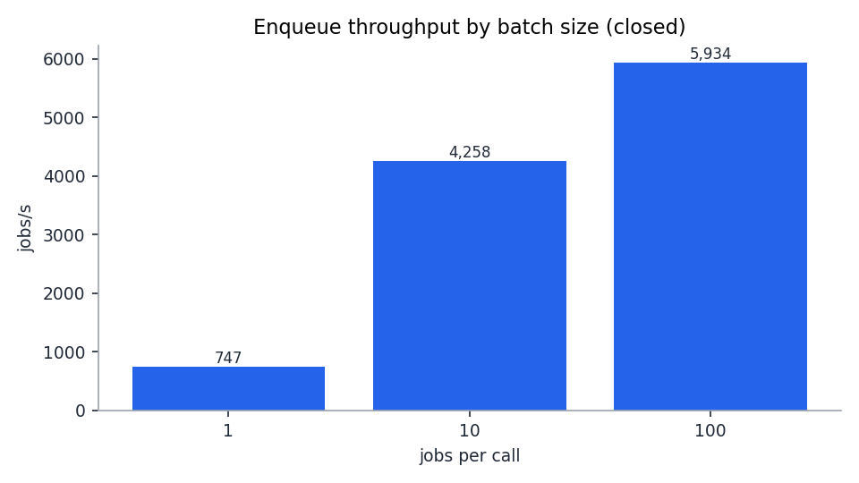
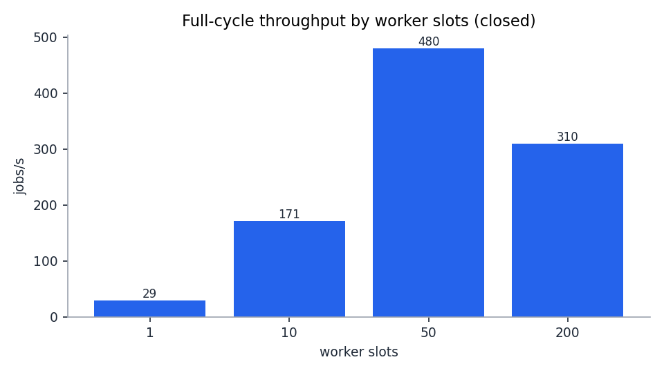
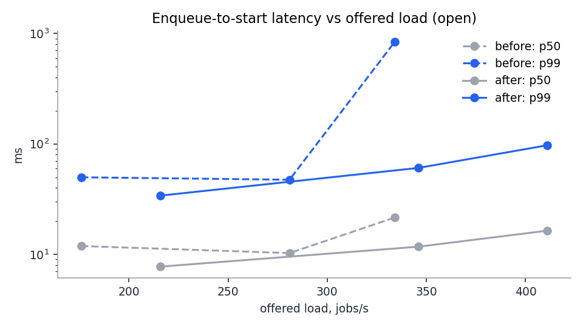
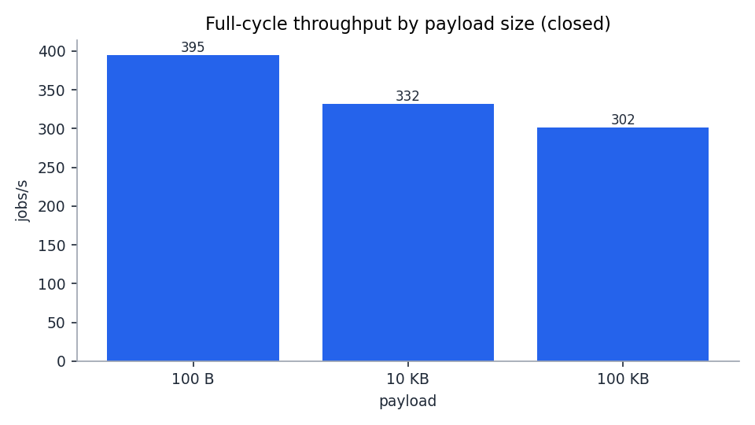

# Tasklane benchmarks (M5a)

A load test of one Tasklane server on one PostgreSQL, on a laptop with pinned CPUs. It answers three questions: how many jobs per second the system handles, where the limit is, and how much CPU each job costs, so the numbers can be scaled to other machines. Three tuning steps came out of it; each has a before/after measurement below.

The plan is [design §19](design.md#19-m5a-load-tests-tuning-and-benchmark-report). Every number here comes from a committed results file under [`bench/results/`](../bench/results/). A number is cited as `<directory>:<run label>`, using these short names:

| Short name | Directory | What it holds |
|---|---|---|
| `base` | `2026-11-06-laptop` | The first full suite, before any tuning |
| `exp` | `2026-11-06-laptop-experiments` | Baseline repeats and the connection-pool experiment |
| `step1` | `2026-11-06-laptop-step1` | After tuning step 1 (S1, S2, and repeats for medians) |
| `step2` | `2026-11-06-laptop-step2` | After tuning step 2 (S4, S6, the latency curve, a paired tracing check) |
| `step3` | `2026-11-06-laptop-step3` | After tuning step 3 (S4) |

Each directory has `results.csv` (one row per run), `details/<label>.json` (top queries from `pg_stat_statements`, sampled wait events, table counters) and, for S4, `plans/<label>.txt` (query plans from `auto_explain`).

Words used below:

- **Job, full cycle:** one job enqueued, leased by a worker and acknowledged (Ack). Throughput counts acked jobs per second.
- **Enqueue-to-start latency:** the time from a job's *planned* send time to the moment its handler starts. "p99" is the 99th percentile: 1 job in 100 waited longer.
- **Closed load:** a fixed number of clients, each sending its next request when the last one returns. It finds the maximum throughput, called **M**.
- **Open load:** requests sent on a fixed schedule (for example 346 jobs/s), whether or not the server keeps up. Used for latency.
- **CPU per job:** CPU time a container used during the 60 s window, divided by the jobs done in it.
- **Wait events:** what each Postgres backend was waiting for, sampled from `pg_stat_activity`. "Lock:object 30%" means 30% of the samples were waiting for that lock.
- **Worker slots:** how many jobs the workers can run at once (`Concurrency`, summed over worker processes).

## 1. Hardware and CPU layout

| Part | Value |
|---|---|
| Machine | Laptop, Intel Core i5-7200U: **2 physical cores, 4 hardware threads** (hyper-threading), 7.6 GB RAM, SSD |
| PostgreSQL | 17 (`postgres:17-alpine`), default settings except `pg_stat_statements` and `auto_explain` preloaded |
| Tasklane server | Go 1.27, one copy, default settings (connection pool of 4, the pgx default for one CPU) |
| Load generator | `bench/loadgen` (Go); workers use the real Go SDK; handlers do nothing |
| Each run | 10 s warm-up (not counted), then a 60 s measured window, on an emptied `jobs` table (except S4) |

Each part runs on its own CPUs (`cpuset` in Docker, `taskset` for the load generator):

| CPUs | Runs |
|---|---|
| 0 and 2 (both threads of core 0) | Postgres |
| 1 (one thread of core 1) | Tasklane server |
| 3 (the other thread of core 1) | Load generator: producers and workers |

**Read this first: the hyper-threading caveat.** The server and the load generator share one physical core. When both are busy, each gets roughly 60–65% of a core, not a full one. Postgres's "2 CPUs" are also one physical core. So the absolute numbers are small and specific to this laptop. They are useful for two things: comparing before and after on the same machine, and CPU per job, which section 6 turns into numbers for other machines.

**Noise.** Closed full-cycle runs with the same settings varied by about ±20%: 352, 532 and 392 jobs/s (`base:s2-closed-w50`, `exp:exp-pool4-a`, `exp:exp-pool4-b`). So small effects (like step 1's +10%) are judged on the median of 3–4 runs or on a back-to-back pair. Single runs are compared only where the change is many times larger than the noise, as in steps 2 and 3.

**Invalid runs.** A run with a server crash or more than 1% failed RPCs is marked `valid=false` in its row. None of the committed runs is invalid, and none recorded an error or a dropped request.

## 2. Results per scenario

### S1: enqueue only (no workers), batch size 1, 10, 100

Closed with 16 producers, then open at 80% of that maximum. Batch size is jobs per enqueue call; one call is one transaction.

| Batch | Max jobs/s (closed) | Server CPU per job | Postgres CPU per job | WAL per job | Enqueue call p99 at 80% |
|---|---|---|---|---|---|
| 1 | 747 | 0.69 ms | 1.13 ms | 604 B | 268 ms at 597 jobs/s |
| 10 | 4,258 | 0.12 ms | 0.38 ms | 445 B | 377 ms at 3,406 jobs/s |
| 100 | 5,934 | 0.065 ms | 0.30 ms | 447 B | 174 ms at 4,747 jobs/s |

Source: `base:s1-*`, before tuning. After step 1 the single-job maximum rose to a median of 1,048 jobs/s (section 5); batches of 10 and 100 changed little (4,547 and 5,891, `step1:s1-closed-b10`, `step1:s1-closed-b100`).

Batching is the biggest lever in the whole report: 100 jobs per call is **7.9 times** the throughput of one per call, and Postgres CPU per job drops from 1.13 to 0.30 ms, because 100 jobs share one transaction and one commit.



*Chart: `base:s1-closed-b*`, before tuning.*

### S2: full cycle by worker slots (closed)

| Worker slots | Before tuning (`base`) | After step 1 (`step1`) |
|---|---|---|
| 1 | 21 jobs/s | 29 jobs/s |
| 10 | 116 jobs/s | 171 jobs/s |
| 50 | 352 jobs/s (median of 3 runs: **392**) | 480 jobs/s (median of 4 runs: **433**) |
| 200 | 293 jobs/s | 310 jobs/s |

Single runs except the medians. The medians use `base:s2-closed-w50`, `exp:exp-pool4-a`, `exp:exp-pool4-b` (352, 532, 392) and `step1:s2-closed-w50`, `step1:rep-s2-closed-w50-1..3` (480, 416, 405, 450).

- **50 slots is the best count**, so S3, S4 and S6 use 50.
- With 1 and 10 slots the workers are the limit: producers ran ahead (35,768 enqueued vs 1,251 acked at 1 slot, `base:s2-closed-w1`), so latency in those runs is just time spent in a growing backlog.
- **200 slots are slower than 50**, not faster. More slots means more Acks in flight at once, and they compete: the Ack `UPDATE` took 0.32 ms on average at 50 slots and 2.75 ms at 200 (`base:s2-closed-w50`, `base:s2-closed-w200`, from `pg_stat_statements`), and Postgres CPU per job rose from 2.48 to 4.28 ms.



*Chart: `step1:s2-closed-w*`, after step 1. Single runs: the 480 at 50 slots is the highest of the four step 1 runs (median 433).*

### S2: latency against load (open, 50 slots)

| Load | Before tuning: M = 352 (`base`) | After step 2: M = 433 (`step2`) |
|---|---|---|
| 50% of M | 176 jobs/s: p50 11.9 ms, p99 50 ms | 216 jobs/s: p50 7.7 ms, p99 34 ms |
| 80% of M | 281 jobs/s: p50 10.3 ms, p99 47 ms | 346 jobs/s: p50 11.7 ms, **p99 61 ms** |
| 95% of M | 334 jobs/s: p50 21.5 ms, **p99 837 ms** | 411 jobs/s: p50 16.4 ms, **p99 97 ms** |

Sources: `base:s2-open{50,80,95}-w50` and `step2:open{50,80,95}-w50-medianM-1`. Lease requests per job in the "after" runs: 0.89, 0.46 and 0.29 (fewer at higher load, because each lease returns several jobs).

After tuning, the system carries 23% more load at 95% (411 against 334 jobs/s) and its p99 there is 97 ms instead of 837 ms.

A warning from the data: the suite's own step 1 open runs (`step1:s2-open80-w50`, `step1:s2-open95-w50`) took their rates from one closed run of 480 jobs/s, a high sample. Their 383 and 455 jobs/s were 88% and 105% of the median M of 433, and their p99 was 2,380 and 2,281 ms: the queue was at or over its capacity. That is why the curve was measured again at 50/80/95% of the **median** M in step 2.



*Chart: dashed lines `base:s2-open*-w50` (before), solid lines `step2:open*-w50-medianM-1` (after); log scale.*

### S2-idle and S2-trickle: 200 slots (4 worker processes)

| Run | Result |
|---|---|
| Idle, no jobs, 60 s (`base:s2-idle-w200`) | Postgres: **9.6 queries/s**, 5.8% of one CPU. Server: 0.45% of one CPU. Each of the 4 waiting long-polls re-checks once a second, plus the depth refresh and the reaper. |
| Trickle, 5 jobs/s (`base:s2-trickle-w200`) | **1.0 lease request per job**, p99 31.5 ms. After step 1: 1.0, p99 33.2 ms (`step1:s2-trickle-w200`). |

### S3: payload size (50 slots, closed, before tuning)

| Payload | Max jobs/s | Server CPU per job | WAL per job |
|---|---|---|---|
| 100 B | 395 | 0.95 ms | 1,243 B |
| 10 KB | 332 | 1.52 ms | 1,305 B |
| 100 KB | 302 | 2.16 ms | 2,843 B |

Source: `base:s3-closed-p*`, single runs. Server CPU per job roughly doubles from 100 B to 100 KB: that is the JSON ↔ protobuf conversion and copying.

**Caveat:** the test payload is a run of the letter `x` (`bench/loadgen/payload.go`). Postgres compresses large values, so this payload compresses almost to nothing, and the WAL numbers understate what real, less compressible payloads would write. The open runs of S3 (`base:s3-open80-p*`) are not used: each took its rate from its own single closed run, and two of the three were over capacity (p99 5,341 ms and 4,895 ms).



*Chart: `base:s3-closed-p*`, before tuning.*

### S4: a big table (open at 80% of M, 50 slots)

S4 preloads 1,000,000 available jobs into a queue called `backlog` that no worker reads, then runs the normal full cycle on another queue on top of it.

| Run | Before (`base`, 281 jobs/s) | After step 2 (`step2`, 346 jobs/s) | After step 3 (`step3`, 346 jobs/s) |
|---|---|---|---|
| s4b: 1M backlog, p99 | 46 ms | 233 ms | **61 ms** |
| s4b: depth count, calls per minute × mean | 60 × 610 ms | 60 × 438 ms | 12 × 431 ms |
| s4b: Postgres time spent counting, per minute | 36.6 s | 26.3 s | **5.2 s** |
| s4b: Postgres CPU | 130% of one CPU | 134% | 97% |
| s4c: plus 10,000 delayed priority-1 jobs, p99 | 56 ms | 96 ms | 228 ms |
| s4c: lease query mean (s4b → s4c) | 0.31 → 1.47 ms | 0.44 → 1.60 ms | 0.37 → 1.58 ms |
| s4d: redrive all 100,000 dead jobs | 3.04 s | 3.36 s | 2.93 s |
| s4e: 1,000 queues, p99 | 9,789 ms | 455 ms | **60 ms** |
| s4e: depth count, calls per minute × mean | 1 × 50,795 ms | 59 × 682 ms | 43 × 123 ms |

The "before" runs used 80% of the baseline M (281 jobs/s); the later runs used 80% of the median M after step 1 (346 jobs/s), so they carried 23% more load. The 1,000-queue run before tuning fell behind: it acked 238 jobs/s of the 281 offered. The depth-query numbers are from `pg_stat_statements` in each run's details file.

- **The 1M backlog does not slow leasing.** The lease query reads only its own queue's part of a partial index, so it stayed under half a millisecond (0.31 ms with the backlog against 0.24 ms on an empty table at the same rate, `base:s2-open80-w50`).
- **Counting the backlog is the cost.** The depth refresh counts available jobs per queue for backpressure and metrics. A count visits every matching row, so it grows with the backlog, and Postgres chose a sequential scan of the table (`base:s4a-explain`). Steps 2 and 3 are about this count.
- **Delayed jobs make each lease slower** (0.37 → 1.58 ms mean in `step3`). The partial index is ordered by priority, then run time, so a lease probably steps over the 10,000 delayed priority-1 entries before it finds a ready job. The p99 effect is unclear: 56, 96 and 228 ms in three single runs. Not fixed (section 7).
- **Redrive-all is linear:** about 100 batches of 1,000 jobs, about 3 s in total (30,000–34,000 jobs/s). The batch plan reads the dead-jobs index and joins on the primary key (Nested Loop with Index Scans, `*/plans/s4d-redrive.txt`); it does not scan the table.

### S6: the cost of tracing (100% sampling, Jaeger on CPU 3)

| Comparison | Untraced | Traced | Difference |
|---|---|---|---|
| Paired runs, 20 s each, 346 jobs/s (`step2:s6check-untraced-open80-1`, `step2:s6check-traced-open80-1`) | 0.91 ms server CPU per job, p99 166 ms | 1.25 ms, p99 1,152 ms | **+38% CPU per job** |
| Suite, 281 jobs/s (`base:s2-open80-w50`, `base:s6-traced-open80-w50`) | 1.34 ms, p99 47 ms | 2.02 ms, p99 86 ms | +51% |
| Idle, 200 slots (`base:s2-idle-w200`, `base:s6-traced-idle-w200`) | 0.45% of one CPU | 0.68% | +0.2 points |

Compare CPU per job, not latency: Jaeger runs on the load generator's CPU, so the traced runs also slow the clients. At 346 jobs/s the traced suite run fell behind (it acked 315 jobs/s, p99 12 s, `step2:s6-traced-open80-w50`). Tracing every job costs about 40–50% more server CPU per job; idle long-poll traces cost almost nothing. For production, sample a ratio (for example 10%), as the README already advises.

## 3. Charts

The four charts are in section 2, next to their tables:

| Chart | Data | Why from there |
|---|---|---|
| Throughput by worker slots | `step1:s2-closed-w*` | The newest S2 suite |
| p99 against load, 50/80/95% | `base:s2-open*-w50` vs `step2:open*-w50-medianM-1` | Before and after, on one chart |
| Batch-size gains | `base:s1-closed-b*` | The suite run; step 1 changed only batch 1 (section 5) |
| Payload cost | `base:s3-closed-p*` | S3 ran only in the baseline |

Regenerate them with `bench/plot/plot.sh` (it runs matplotlib in a throwaway Python container):

```bash
bench/plot/plot.sh bench/results/2026-11-06-laptop --only s1-batch,s3-payload
bench/plot/plot.sh bench/results/2026-11-06-laptop-step1 --only s2-throughput
bench/plot/plot.sh bench/results/2026-11-06-laptop-step2 --only s2-latency-vs-load \
  --before bench/results/2026-11-06-laptop
```

## 4. The bottleneck: NOTIFY's commit lock

Before tuning, the full cycle peaked at a median of 392 jobs/s with neither side's CPU full. How the evidence pointed to the cause:

1. **CPU was not the limit.** In `base:s2-closed-w50` the server used 56% of its one CPU and Postgres 87% of one CPU, out of the two it had.
2. **Postgres was waiting, not working.** Its wait samples: `Lock:object` 31%, `IO:WalSync` 28%, `LWLock:WALWrite` 25%, CPU 14%. With enqueues alone (`base:s1-closed-b1`), `Lock:object` was 55%.
3. **The lock belongs to NOTIFY.** Every `Enqueue` called `pg_notify` inside its transaction, to wake waiting workers. Postgres delivers notifications in commit order, so a transaction that sent one takes a database-wide lock at commit and keeps it until its commit is flushed to disk. The wait event for that lock is `Lock:object`. So enqueue commits went through one at a time, each waiting for the previous one's disk flush. The `pg_notify` call itself was cheap (0.009 ms mean in `pg_stat_statements`); the cost was the lock at commit.
4. **More connections made it worse.** With a pool of 16 connections instead of 4, throughput did not rise (385 and 349 jobs/s against 532 and 392, `exp:exp-pool16-*`, `exp:exp-pool4-*`) and `Lock:object` grew to about 80% of samples. More connections just meant more of them queued on the same lock. So the pool was not the limit; one serial step was.

The fix is tuning step 1. After it, `Lock:object` did not appear in any run's samples. What remains is the WAL: `LWLock:WALWrite` plus `IO:WalSync` were 72% of samples with enqueues alone (`step1:s1-closed-b1`) and 83% in the full cycle (`step1:s2-closed-w50`). Every commit waits for its WAL record to reach the SSD, and a job needs several commits (enqueue, its share of a lease, ack). That flush is now the floor; section 6 discusses what could move it.

## 5. Tuning steps

Three steps, each its own commit, each followed by a rerun of the affected scenarios.

### Step 1: NOTIFY after commit, coalesced per queue (commit `bc6de74`)

**Change.** The store no longer calls `pg_notify` inside the enqueue (or redrive) transaction. After the commit, the API server wakes its own waiting leases in memory at once and sends one `pg_notify` per queue per 5 ms window for the other servers.

**Why it is safe.** A rolled-back enqueue never reaches the publish step, so nobody is woken for nothing. If the server crashes between commit and publish, or a NOTIFY fails, waiting leases still find the job at their next once-a-second re-check, the same as for any lost notification. So the worst case is one extra second of latency, never a lost job.

| Measurement | Before | After |
|---|---|---|
| Enqueue only, batch 1 (median) | 747 jobs/s (747, 789, 619) | **1,048 jobs/s** (1,271, 1,012, 1,043, 1,052): **+40%** |
| Full cycle, 50 slots (median) | 392 jobs/s (352, 532, 392) | **433 jobs/s** (480, 416, 405, 450): **+10%** |
| `Lock:object` share of wait samples | 31% (full cycle), 55% (enqueue only) | 0% |

Sources: `base:s1-closed-b1`, `exp:base-s1-closed-b1-{b,c}`, `step1:s1-closed-b1`, `step1:rep-s1-closed-b1-{1,2,3}`; the full-cycle sources are under S2 in section 2.

**A side effect.** A server now wakes its own leases twice: once in memory, then again when its own NOTIFY comes back about 5 ms later. At 5 jobs/s with 4 waiting long-polls, Postgres ran 1,597 lease queries per minute before step 1 and 2,523 after (`base:s2-trickle-w200`, `step1:s2-trickle-w200`), about 4.5 against 7.6 per job once the 240 per minute of idle re-checks are taken out, and its CPU rose from 22% to 31% of one CPU. Lease *requests* per job stayed at 1.0, so workers see no difference. It is small at this scale; the fix (a server ignoring its own notifications) is listed in section 7.

### Step 2: count queue depths in one pass; JIT off (commit `34f5fbc`)

**Change.** The depth query used to run one count per queue (a subquery for each row of `queues`). Now it counts all queues in one grouped pass over `jobs`. The server also turns off Postgres's JIT compiler for its connections (unless the connection URL sets it): JIT compiles a query to machine code, which pays off only for long analytic queries.

| Measurement | Before | After |
|---|---|---|
| Depth query, 1,000 queues (`s4e`) | 50,795 ms per call | 682 ms |
| p50 / p99, 1,000 queues | 2,353 / 9,789 ms (at 281 jobs/s) | 13.7 / 455 ms (at 346 jobs/s) |
| Depth query, 1M backlog (`s4b`) | 610 ms mean | 438 ms mean |

JIT was 243 ms of one 710 ms run of the old query (`base`: `plans/s4a-explain.txt`); the new plan has no JIT section (`step2`: `plans/s4a-explain.txt`).

**What it did not fix.** With the 1M backlog, the count still took about 440 ms, once a second: 26.3 s of Postgres time per minute, and p99 rose to 233 ms (`step2:s4b-open80-w50`).

### Step 3: space depth refreshes by their cost (commit `ad01375`)

**Change.** After each refresh, the next one waits 10 times as long as this one took, but at least 1 s and at most 5 s. A failed refresh retries after 1 s.

**Why 10×.** The gap between two refreshes is the wait plus the count. For counts of about 100–500 ms, the wait is 10× the count, so counting uses about 1/11 (9%) of one Postgres backend's time. Shorter counts cost less (a 20 ms count every 1 s is 2%). Above 500 ms the wait stops at 5 s, so the share rises again (a 1 s count would be 1/6). The 5 s cap keeps the counts fresh enough: the server trusts its last counts for at most 10 s before it stops refusing enqueues (it fails open).

| Measurement (`step2` → `step3`) | Before | After |
|---|---|---|
| Depth counts per minute, 1M backlog | 60 | 12 |
| Postgres time spent counting, per minute | 26.3 s | **5.2 s** |
| p99, 1M backlog | 233 ms | **61 ms** |
| Postgres CPU, 1M backlog | 134% of one CPU | 97% |
| p99, 1,000 queues | 455 ms | **60 ms** |

**The cost.** Backpressure is soft: a queue can go over `max_depth` by the traffic of one refresh interval. That interval used to be 1 s; with a slow count it is now up to 5 s.

## 6. Capacity maths

The formula, for each side (server and Postgres):

```
max jobs/s ≈ CPUs × 1000 / (CPU ms per job)
```

1000 is the milliseconds in one second of one CPU. If a job costs 2 ms of CPU, one CPU does at most 500 jobs a second.

**This laptop.** CPU per job at 80% load after tuning (`step2:open80-w50-medianM-1`):

| Side | CPU per job | CPUs | CPU ceiling |
|---|---|---|---|
| Server | 1.29 ms | 1 | 1 × 1000 / 1.29 ≈ **775 jobs/s** |
| Postgres | 2.87 ms | 2 | 2 × 1000 / 2.87 ≈ **697 jobs/s** |

The measured maximum was a median of 433 jobs/s, below both CPU ceilings. The real limit on this laptop is the per-commit WAL flush (section 4), not CPU. The CPU ceilings say how far the system could go once commits are cheaper (batching, faster disk) and before CPU runs out. Two more cautions: Postgres's "2 CPUs" are one physical core, so its real ceiling is lower; and CPU per job depends on load. At 50% load Postgres used 4.52 ms per job and at 95% 2.22 ms (`step2:open50-*`, `step2:open95-*`), because fixed costs (idle re-checks, the depth refresh) are shared by fewer or more jobs and leases carry more jobs at once when busy.

**How many servers fill one Postgres.** Divide the two costs: 2.87 / 1.29 ≈ 2.2. One server CPU produces enough work to keep about 2.2 Postgres CPUs busy.

**An 8-vCPU example.** Say Postgres gets its own 8 vCPUs and you use this laptop's per-job costs:

- Postgres CPU ceiling: 8 × 1000 / 2.87 ≈ **2,790 jobs/s**.
- Server CPUs to reach that: 2,790 × 1.29 / 1000 ≈ 3.6, so **4 server CPUs** (for example 4 one-CPU copies).
- With batched enqueues of 100 (Postgres 0.30 ms per job for the enqueue alone, `base:s1-closed-b100`), the enqueue share of each job's cost falls sharply; measure the full cycle with batching before counting on it.

This is arithmetic, not a measurement: a real 8-vCPU machine has a different disk, so its commit floor, and full cores instead of shared threads. Use your own CPU-per-job numbers: run the suite with `PROFILE=vm` (section 8) and put them into the formula.

**What would move the commit floor.** `synchronous_commit = off` makes a commit return before its WAL is flushed; Postgres then flushes in the background within about 3 × `wal_writer_delay` (600 ms by default). On a crash, the last fraction of a second of commits is lost even though clients were told they succeeded. For a job queue that means an enqueue the producer saw succeed can disappear: a lost job. It was discussed, not turned on, and not measured. A narrower option is to turn it off only for Acks (`SET LOCAL` in that transaction): a lost Ack only means the job runs again, which at-least-once delivery already allows. Batching (more jobs per commit) is the safe lever and is already available for enqueues.

## 7. Verdicts for the parked checks

Every question the earlier milestones left for the load test, with its answer.

| Check | Verdict | Number |
|---|---|---|
| NOTIFY's commit lock serializing enqueues | **Fixed** (step 1) | `Lock:object` 31–55% of wait samples → 0%; enqueue +40%, full cycle +10% (medians) |
| Depth count is O(backlog) and scans the table | **Fixed: cost bounded** (steps 2 and 3); each count is still O(backlog) | 1M backlog: 36.6 s → 5.2 s of Postgres time per minute; p99 61 ms |
| Cost of many queues | **Fixed** (step 2) | 1,000 queues: 50.8 s → 0.68 s per depth query; p99 9,789 → 60 ms |
| JIT on short queries | **Fixed** (step 2, found during S4) | 243 ms of one 710 ms depth query |
| Thundering herd: one NOTIFY waking every waiting worker | **Not needed at this scale** | 1.0 lease request per job at 5 jobs/s with 4 waiting long-polls; p99 31.5 ms. Each wake costs one lease query per waiting long-poll; that grows with the number of worker processes on a queue. |
| `LeaseStream` (build only if the long-poll is a bottleneck) | **Deferred; trigger not hit** | About 1.0 lease request per job or less in every run (0.29–0.89 on the latency curve, 1.0 at 5 jobs/s); p99 61 ms at 80% load. Trigger: lease requests per job well above 1, or lease round trips showing up in p99. |
| Server waking its own leases twice (found in step 1) | **Deferred** | 2,523 vs 1,597 lease queries per minute at 5 jobs/s. Trigger: lease queries in the top `pg_stat_statements` entries at low load. Fix: tag each NOTIFY with the sending server and skip its own. |
| Delayed jobs scanned by every lease | **Deferred** | 10,000 delayed priority-1 jobs: lease mean 0.37 → 1.58 ms; p99 56–228 ms over three single runs. Trigger: the lease statement in the top `pg_stat_statements` entries, or many delayed high-priority jobs per queue. |
| Redrive-all hash join and table scan (parked in M3a) | **Not needed** | 100,000 jobs in about 3 s; the batch plan uses index scans and a Nested Loop (`plans/s4d-redrive.txt`) |
| HOT updates and `fillfactor = 70` | **Not needed** | 0 HOT updates in every run (0 of 41,903 updates in `base:s2-closed-w50`), as migration 0001 predicted: each state change also changes an indexed column, so spare page room cannot make updates HOT. 70 vs 100 was not compared. |
| Autovacuum settings | **Not needed for the tested sizes; deferred for big backlogs** | Small table: one autovacuum per 60 s window; at most 45,170 dead rows at the end of a window (`step1:s2-open95-w50`). With the 1M backlog no autovacuum ran in the window and dead rows grew from 11,942 to 53,297 (`step3:s4b-open80-w50`). By arithmetic, the default threshold (20% of the table) is about 200,000 dead rows, so about 5 minutes at this rate. Trigger: a large standing backlog; then lower `autovacuum_vacuum_scale_factor` for `jobs`. |
| Connection pool size | **Not needed** | Pool 16 vs 4: no gain (385/349 vs 532/392 jobs/s), `Lock:object` ~80% |
| 200 worker slots | **Not needed** (a sizing finding) | 293 jobs/s vs 352 at 50 slots: Ack `UPDATE` 0.32 → 2.75 ms. Fewer, busier slots are faster here. |
| Idle long-poll cost | **Not needed** | 9.6 Postgres queries/s, 5.8% of one CPU, with 200 idle slots |
| Payload cost (JSON ↔ protobuf) | **Not needed** | 100 KB: 302 vs 395 jobs/s at 100 B; server CPU per job 0.95 → 2.16 ms. The test payload compresses well, so real WAL per job would be higher. |
| Tracing cost at 100% sampling, and trimming idle `Lease` traces | **Not needed; sample a ratio in production** | +38% server CPU per job at 100% sampling (paired runs; +51% in the suite runs); idle traced server about 0.7% of one CPU (+0.2 points over untraced) |
| Tracing-off overhead (the +3.5% of design §18) | **Deferred: not measured in M5a** | M4c micro-benchmark: +3.5%. Trigger: re-measure when skipping otelgrpc/otelpgx for a no-op provider (the M4c follow-up) is built. |
| Two server copies vs one | **Deferred** to M5b (two replicas) or `PROFILE=vm` | Replaced here by capacity maths (section 6): one server CPU feeds about 2.2 Postgres CPUs |
| `synchronous_commit = off` | **Deferred: discussed, not turned on** | Not measured; the trade-off is in section 6 |
| PgBouncer | **Deferred** | Not tested. Trigger: connection count, with many server copies (M5b). |
| Full-queue 429 vs payload-too-large over HTTP | **Done**, as an integration test (not a load question) | `TestOversizeBatchIsNotQueueFull` in `sdk/go/integrationtest` |

## 8. How to reproduce

You need Docker, Go and a quiet machine; a full suite takes about an hour and keeps every CPU busy. The bench stack binds ports 5433, 7070 and 9464, so stop the demo first.

```bash
bench/run.sh                          # full suite, laptop layout (CPUs 0,2 / 1 / 3)
PROFILE=vm bench/run.sh               # 8+ CPUs: Postgres 0-3, server 4-5, load generator 6-7
SMOKE=1 bench/run.sh                  # 5 s windows and small sizes, to check the setup
SCENARIOS="s2 s4" OUT=bench/results/<dir> bench/run.sh   # a subset
M=433 BEST_W=50 SCENARIOS="s4" bench/run.sh               # S4 or S6 without rerunning S2
bench/repeat.sh bench/results/<dir> s2-closed-w50 3 -mode closed -workers 50   # repeats, for medians
docker compose -f bench/compose.bench.yml --profile tracing down -v           # stop the stack
```

Results go to `bench/results/<date>-<profile>/`. Then draw the charts with `bench/plot/plot.sh` (section 3). On another machine, compare CPU per job and wait events rather than raw jobs/s, and use medians: one run is not a result.
